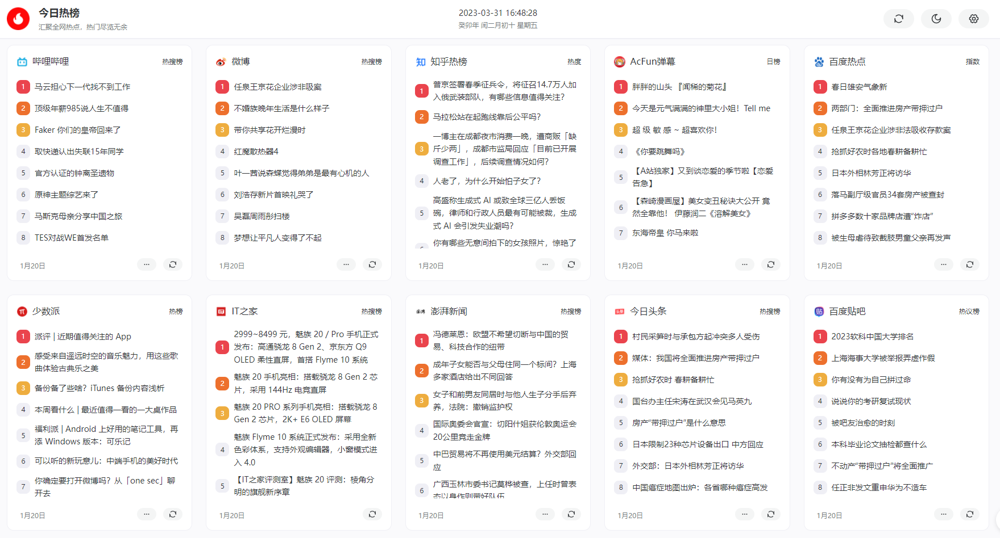

<div align="center">

<h2>今日热榜</h2>
<p>一个聚合热门数据的展示UI</p>
</div>

## 项目介绍

项目非本人原创，来自大佬[imsyy](https://github.com/imsyy)的作品，只是简单的修改了一下，将它的API换成PHP代码，整合到项目，主要功能就是一个热点数据的聚合展示，完全适配移动端，支持暗黑模式，可以自定义开关。基于`Vercel`的演示站：[https://hot.sapi.run](https://hot.sapi.run)，看看效果吧！

仅供学习参考使用，请勿用于商业用途

仅供学习参考使用，请勿用于商业用途

仅供学习参考使用，请勿用于商业用途

仅供学习参考使用，请勿用于商业用途

效果图


## 关注公众号
微信公众号：干货助手


## 优化内容

```
2025/05/28
新增，设置返回
知乎接口不太稳定，需登录才能获取数据

2023/04/02
修复，微博热搜详情页打开提示连接失效
修复，数据时间显示错误

2023/03/31
新增，热搜榜单增加至20个
优化，直接内置API
修复，点击跳转失败
```

## 支持榜单

> 🟢 状态正常
> 🟠 可能失效
> 🔴 无法使用

| **站点** | **类别** | **调用名称** | **状态** |
| -------- | -------- | ------------ | -------- |
| B站热搜 | 热榜   | bilibili     | 🟢        |
| 知乎     | 热榜     | zhihu        | 🟢        |
| 微博     | 热榜   | weibo        | 🟢        |
| AcFun日榜 | 热榜   | acfun        | 🟢        |
| 百度 | 热榜   | baidu       | 🟢        |
| 少数派   | 热榜     | sspai        | 🟢        |
| IT之家   | 热榜     | ithome       | 🟢        |
| 澎湃新闻 | 热榜     | thepaper     | 🟢        |
| 今日头条 | 热榜     | toutiao      | 🟢        |
| 百度贴吧 | 热榜   | tieba       | 🟢        |
| 稀土掘金 | 热榜     | juejin       | 🟢        |
| 腾讯新闻 | 热榜   | tencent       | 🟢        |
| 抖音 | 热榜   | douyin       | 🟢        |
| 搜狗新闻 | 热榜   | sougou       | 🟢        |
| 历史今日 | 热榜   | history       | 🟢        |
| 哔哩哔哩日榜 | 热榜   | biliall       | 🟢        |
| 掘金前端 | 热榜   | juejinqian       | 🟢        |
| 掘金后端 | 热榜   | juejinhou       | 🟢        |
| 掘金代码人生 | 热榜   | juejinlife       | 🟢        |
| 36氪     | 热榜     | 36kr         | 🟢        |

## 部署

```sh
# 安装依赖
pnpm install

# 开发运行
pnpm run dev

# 打包发布
pnpm run build
```

## 鸣谢

- [vercel](https://vercel.com/)
- [DailyHot](https://github.com/imsyy/DailyHot)
- [DailyHotApi](https://github.com/imsyy/DailyHotApi)